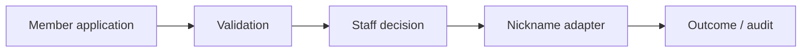

# Discord Nickname Request Workflow

**Moderated user rename requests with role-prefix compatibility**

  

> **Documentation-only portfolio case study.** The source under [`src/public_interface.py`](src/public_interface.py) is intentionally unimplemented and raises `NotImplementedError`. This is **not** a runnable bot, a deployment package or independently verified production evidence.

## Why this module exists

A nickname change seems simple until it has to preserve group naming conventions, route staff approval and avoid Discord permission failures. The feature-level case study describes that review workflow.

**Technology context:** Python, discord.py, modals, staff review interactions. These technologies describe the private module's documented domain; public executable implementation is not provided.

## Workflow at a glance

1. Collect a proposed nickname and the user's reason
2. Validate length, format and any managed prefix expectations
3. Create an identifiable request for staff review
4. Record an approve/reject decision with reviewer context
5. Attempt the change through an authorized adapter and report its outcome

These stages summarize the public project description; the exact runtime and private integration details cannot be independently verified from the public skeleton.

## Engineering challenges

| Topic | Why it matters | How it should be verified |
|---|---|---|
| Concurrent requests | Two requests may race to rename the same member | Define one pending request or explicit supersession |
| Role-prefix overlap | A requested name may already include a managed prefix | Normalize via a shared prefix policy |
| Identity and authority | Approval button visibility is not sufficient security | Re-check staff permissions before applying |
| Discord API failure | Nickname mutation can fail after approval | Preserve decision and record delivery status separately |

## Component boundary

This diagram is **conceptual**, not a snapshot of private production architecture. See the [design notes](docs/ARCHITECTURE.md) for boundaries, failure scenarios and test ideas.

## Repository contents and status

- [`src/public_interface.py`](src/public_interface.py) — non-runnable, documented public interface skeleton
- [`docs/ARCHITECTURE.md`](docs/ARCHITECTURE.md) — engineering design notes (no operational secrets)
- [`examples/config.example.jsonc`](examples/config.example.jsonc) — illustrative configuration shape, **not** a production configuration
- [`NOTICE.md`](NOTICE.md) and [`SECURITY.md`](SECURITY.md) — publication/security boundary

**Portfolio role:** Private-source feature showcase; overlapping support functionality is documented separately. No public tests, executable deployment or usage metrics are claimed here. For verifiable code, inspect the [FastAPI backend demo](https://github.com/Scumbagsss/priority-access-bot), [ticket workflow](https://github.com/Scumbagsss/advanced-discord-ticket-bot) and [monitoring pipeline](https://github.com/Scumbagsss/dayz-server-monitor-bot).

**Related systems:** [discord-role-prefix-bot](https://github.com/Scumbagsss/discord-role-prefix-bot) · [advanced-discord-ticket-bot](https://github.com/Scumbagsss/advanced-discord-ticket-bot).

**Contact:** Discord `scumbagsss` · Telegram [@dilarion](https://t.me/dilarion)
